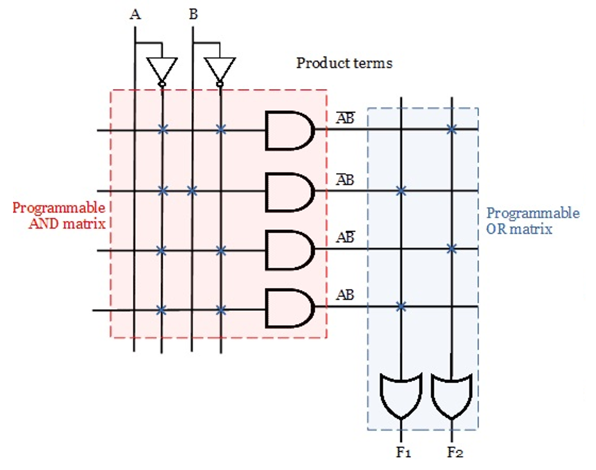
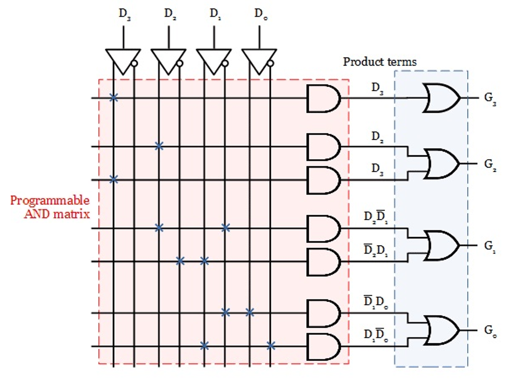
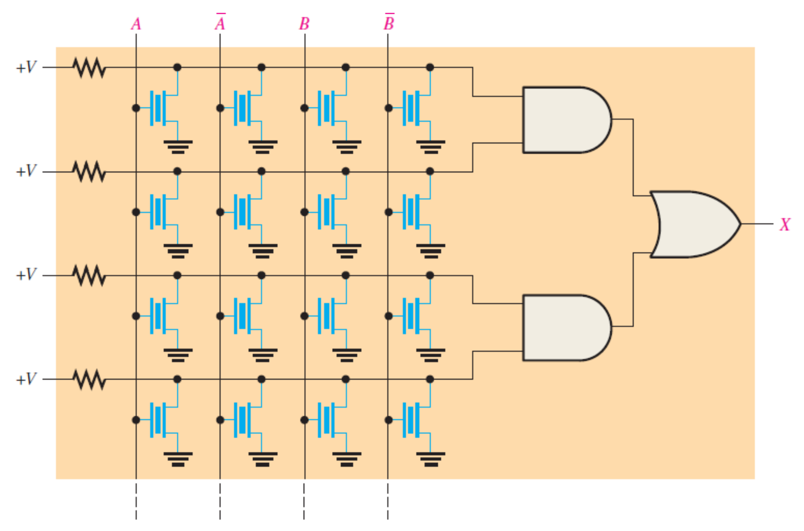
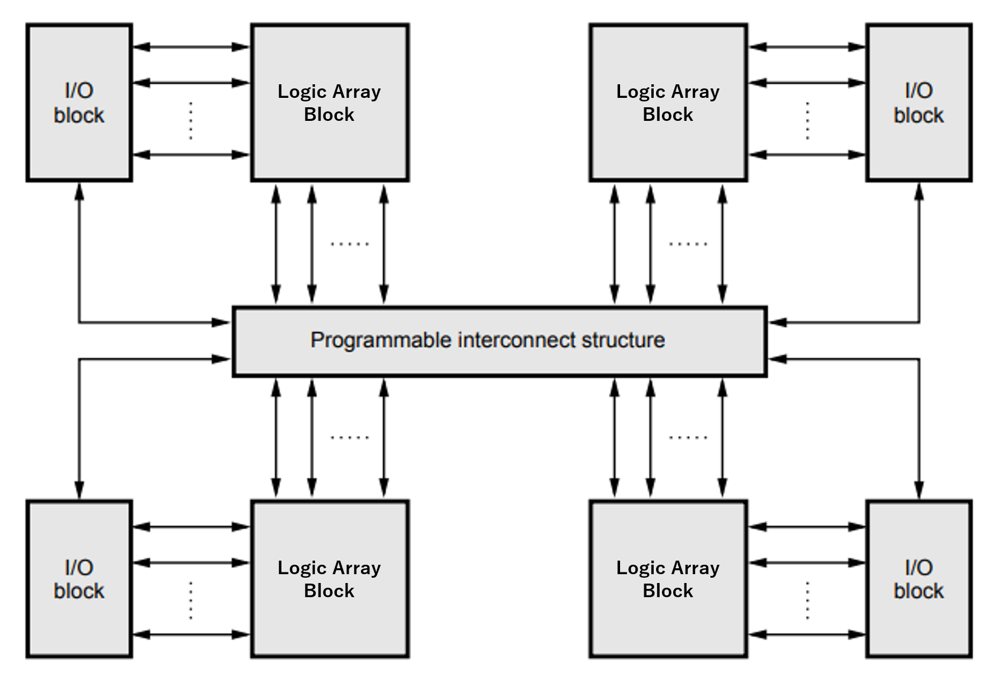

# Simple Programmable Logic Device (SPLD) {#spld}
||Programmable Logic Array (PLA)|Programmable Array Logic (PAL)|Generic Array Logic (GAL)|
|:---:|:---:|:---:|:---:|
|**[Logic Diagram](/stem/physics-and-chemistry/electricity/electronic-circuit/digital-electronics-and-logic-design/digital-electronics-and-logic-design.md#logic-diagram)**||||
|**AND Array**|Programmable|Programmable|Programmable|
|**OR Array**|Programmable|Fixed|Fixed|
|**Reprogrammable**|Depends on model (early versions mostly [OTP](#one-time-programmable-otp))|No ([OTP](#one-time-programmable-otp))|Yes (uses [E²CMOS](/stem/physics-and-chemistry/electricity/electronic-circuit/electronics/transistor/field-effect-transistor/mosfet.md#electrically-erasable-cmos-ecmos), erasable and reprogrammable)|
|**Output Structure**|Connected per design|Relatively fixed|Configurable via [OLMC](#output-logic-macrocell-olmc)|

- ### Output Logic Macrocell (OLMC)
- ### One-Time Programmable (OTP)

# Complex Programmable Logic Device (CPLD) {#cpld}

- ### Logic Array Block (LAB)
- ### Programmable Interconnect
- ### I/O Block

# Field-Programmable Gate Array (FPGA)
- ### [Field-Programmable Gate Array (FPGA)](fpga.md)
