# Logic Family

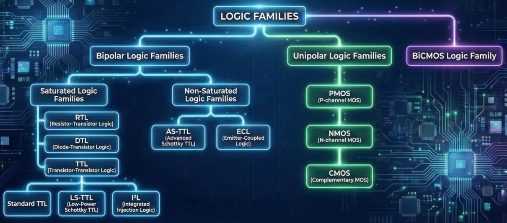

# Transistor-Transistor Logic (TTL)
- ### 7400-series
    |Part number|Description|Pin Layout|
    |:---:|:---:|:---:|
    |7404|Quad 2-Input [NOT Gate](/stem/physics-and-chemistry/electricity/electronic-circuit/digital-electronics-and-logic-design/digital-electronics-and-logic-design.md#logic-gate)|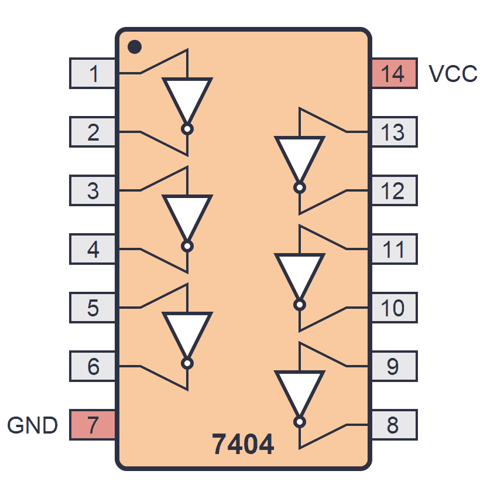|
    |7408|Quad 2-Input [AND Gate](/stem/physics-and-chemistry/electricity/electronic-circuit/digital-electronics-and-logic-design/digital-electronics-and-logic-design.md#logic-gate)|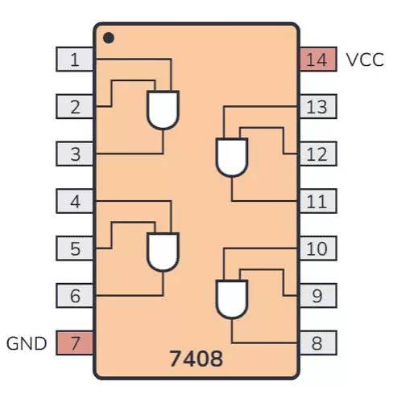|
    |7400|Quad 2-Input [NAND Gate](/stem/physics-and-chemistry/electricity/electronic-circuit/digital-electronics-and-logic-design/digital-electronics-and-logic-design.md#logic-gate)|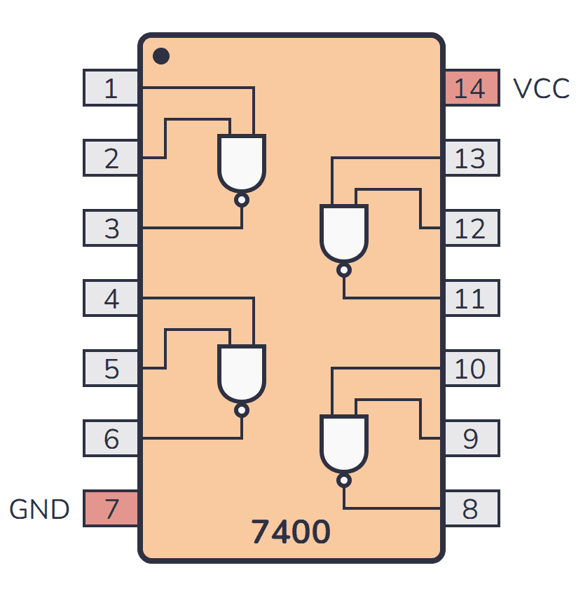|
    |7432|Quad 2-Input [OR Gate](/stem/physics-and-chemistry/electricity/electronic-circuit/digital-electronics-and-logic-design/digital-electronics-and-logic-design.md#logic-gate)|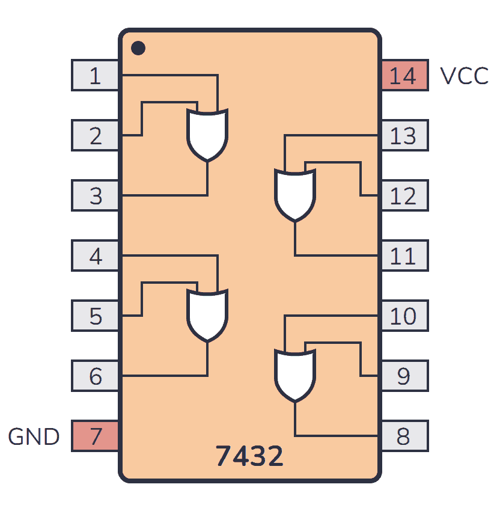|
    |7402|Quad 2-Input [NOR Gate](/stem/physics-and-chemistry/electricity/electronic-circuit/digital-electronics-and-logic-design/digital-electronics-and-logic-design.md#logic-gate)|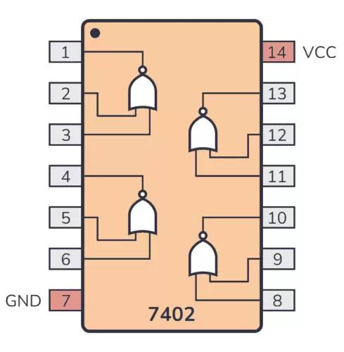|
    |7486|Quad 2-Input [XOR Gate](/stem/physics-and-chemistry/electricity/electronic-circuit/digital-electronics-and-logic-design/digital-electronics-and-logic-design.md#logic-gate)|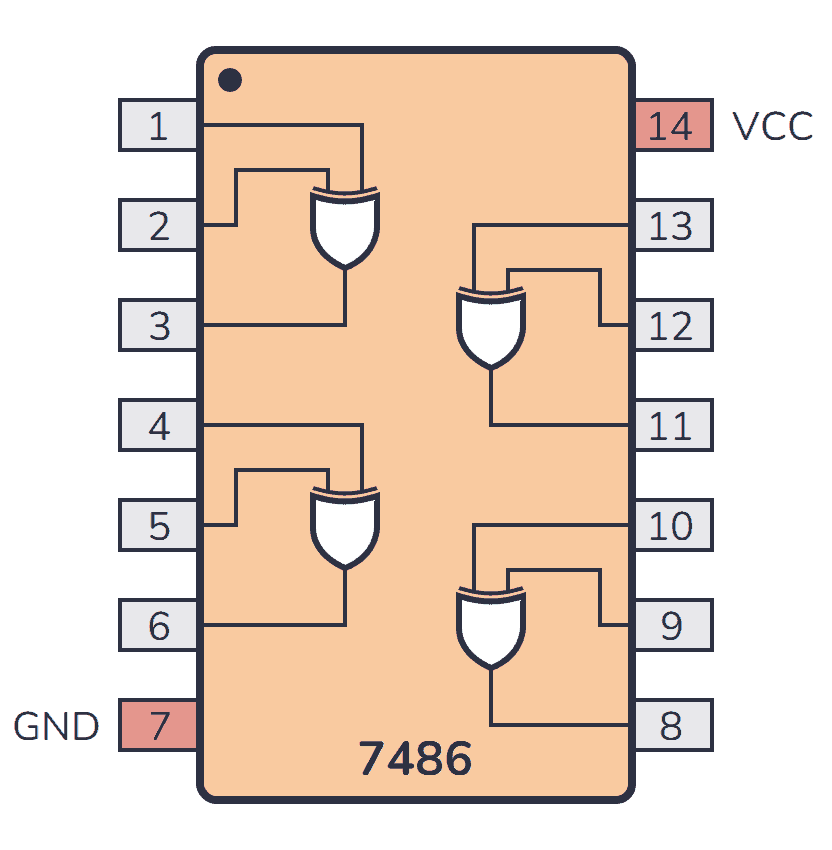|
    |7411|Triple 3-input [AND Gate](/stem/physics-and-chemistry/electricity/electronic-circuit/digital-electronics-and-logic-design/digital-electronics-and-logic-design.md#logic-gate)|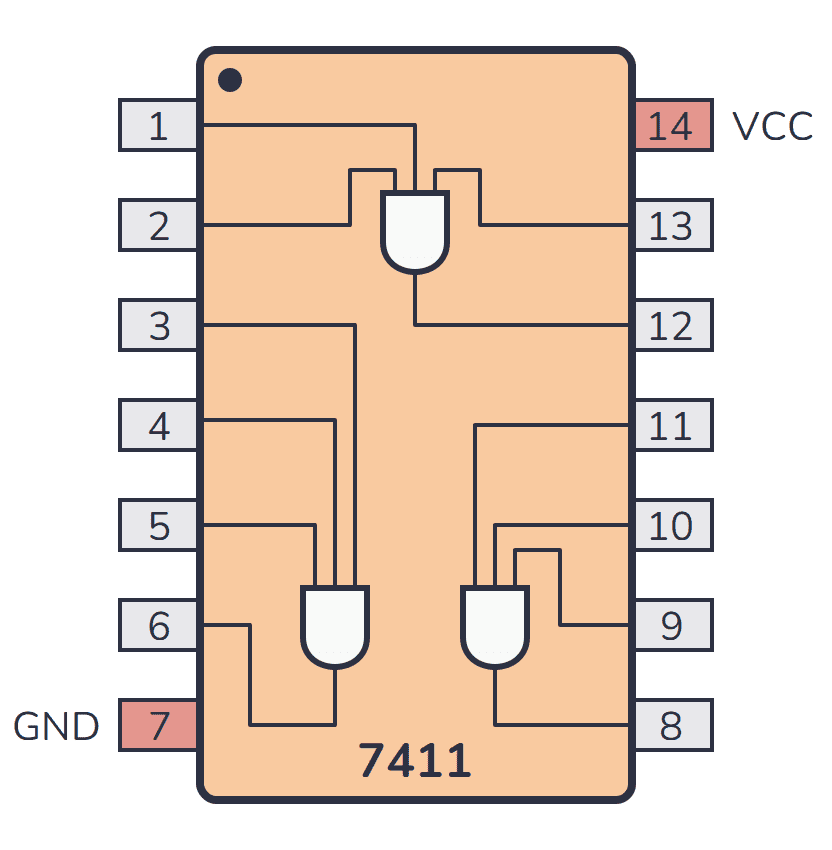|
    |7421|Dual 4-input [AND Gate](/stem/physics-and-chemistry/electricity/electronic-circuit/digital-electronics-and-logic-design/digital-electronics-and-logic-design.md#logic-gate)|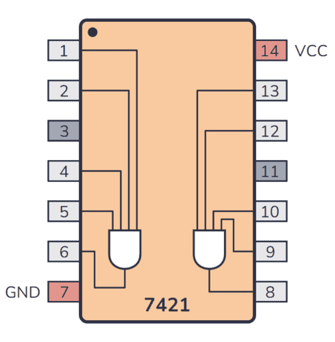|
    |7483|4-bit [Full Adder](/stem/physics-and-chemistry/electricity/electronic-circuit/digital-electronics-and-logic-design/digital-electronics/combinational-logic/adder-and-subtractor/adder.md#full-adder-)|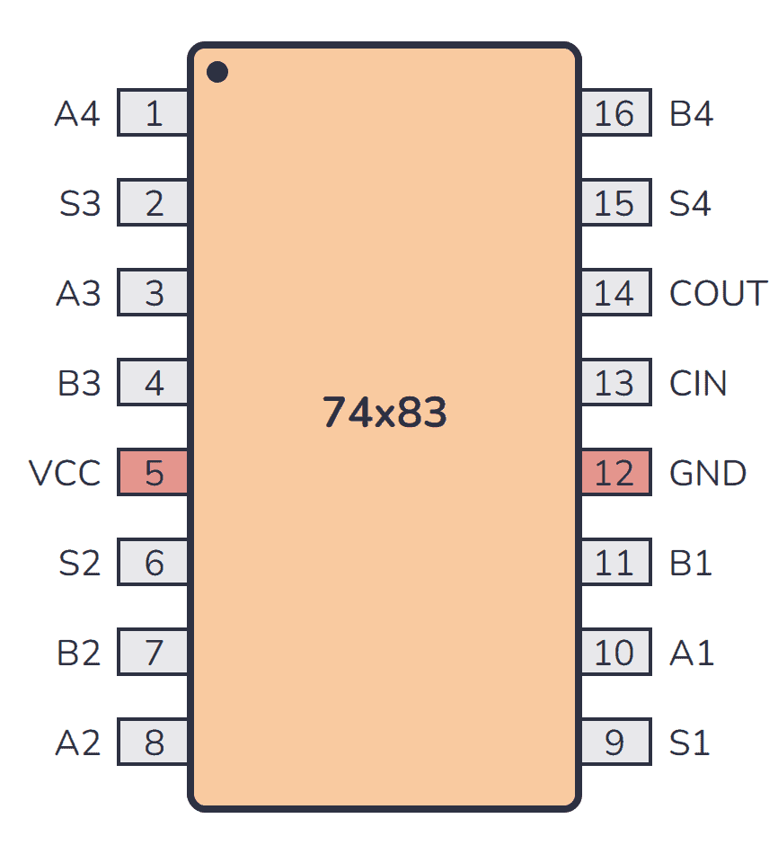|
    |7485|4-Bit Magnitude [Comparator](/stem/physics-and-chemistry/electricity/electronic-circuit/digital-electronics-and-logic-design/digital-electronics/combinational-logic/combinational-logic.md#comparator)|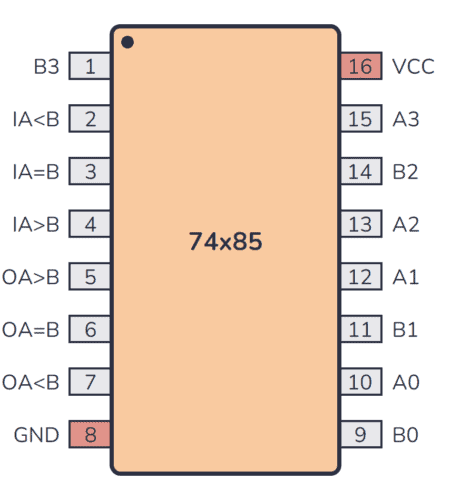|
    |74138|3-Line to 8-Line [Decoder](/stem/physics-and-chemistry/electricity/electronic-circuit/digital-electronics-and-logic-design/digital-electronics/combinational-logic/combinational-logic.md#decoder)|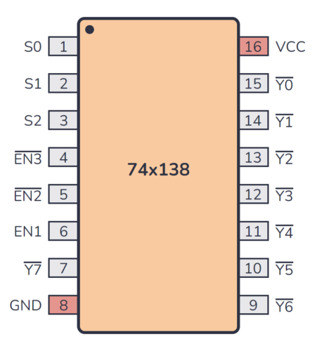|
    |74151|8-to-1 [Multiplexer](/stem/physics-and-chemistry/electricity/electronic-circuit/digital-electronics-and-logic-design/digital-electronics/combinational-logic/combinational-logic.md#multiplexer-mux)|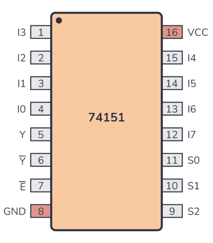|
    |7447|Seven Segment Display [Decoder](/stem/physics-and-chemistry/electricity/electronic-circuit/digital-electronics-and-logic-design/digital-electronics/combinational-logic/combinational-logic.md#decoder)|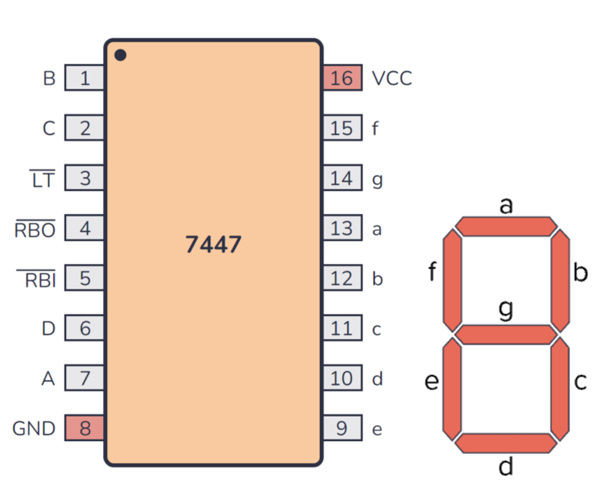|
# Resistor-Transistor Logic (RTL)

# Emitter-Coupled Logic (CTL)

# [CMOS](/stem/physics-and-chemistry/electricity/electronic-circuit/electronics/transistor/field-effect-transistor/mosfet.md#complementary-mosfet-cmos) Logic

# [Bipolar](/stem/physics-and-chemistry/electricity/electronic-circuit/electronics/transistor/bipolar-junction-transistor/bipolar-junction-transistor.md) [CMOS](/stem/physics-and-chemistry/electricity/electronic-circuit/electronics/transistor/field-effect-transistor/mosfet.md#complementary-mosfet-cmos) Logic (BiCMOS Logic)
